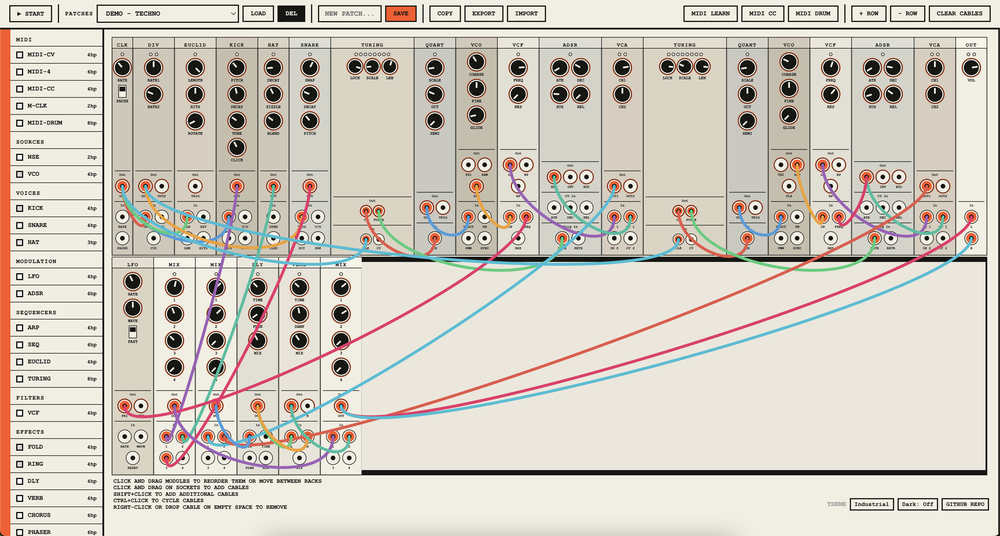

# eurorack-js

Browser-based Eurorack modular synthesizer and patch-sharing community. Build a rack, make sounds, and share your patches for other people to play and remix.

**[Try it live](https://eurorackjs.orderandchaos.xyz)**



## Patches and community

Play the synth and explore public patches without an account. Sign in with Google to save patches to your account, publish your own, and give other people's patches a thumbs-up.

- **Discover patches.** Browse **Public patches** with rack previews, descriptions, and creator credits. Open any patch directly in the rack to play it or try changes.
- **Find something new.** Search the catalogue and sort by **Newest** or **Most popular**, ranked by thumbs-up received across all time, the past day, week, month, or year. Search, filters, and cursor-based pagination live in the URL, so links, refresh, and browser back/forward preserve your place.
- **Save privately or publish.** **My patches** brings together browser saves and account patches. Account patches can be private or public, and you can change their visibility later. Give any save a name; account saves also have a description.
- **Copy and remix.** **Save a copy** makes an independent patch. Copies of account patches preserve the original creator's credit and record their source like a fork. Account copies start private; save again and choose Public when you're ready to share yours.
- **Give a thumbs-up.** Like other people's public patches, or remove your thumbs-up later. These votes determine the popularity rankings.
- **Choose your public name.** Open **My profile** beside Sign out to update the name shown on your account patches and creator credits on account copies. Those credits update without resaving each rack; browser copies retain their imported credit text. Your email address is not displayed publicly.

### Sharing links

Saved account patches have a stable URL at `/patches/<ULID>`. **Copy URL** shares that address, and saving from the rack updates the browser URL to match. Visitors open the saved patch directly in the rack, and later saves appear at the same address. Private patches remain accessible only to their owner.

Public saved patches include Open Graph and Twitter/X cards with the patch title, description, and a rack-only image. Rack previews are refreshed on save, with thumbnail, full-size, and social-card images generated then and cached for subsequent views.

**Copy snapshot link** shares the current rack, including unsaved edits, inside the URL fragment (`#patch=…`). It is a fixed snapshot and does not follow later saves. Snapshot links do not have patch-specific social cards; use a public saved patch's **Copy URL** for those.

## Test and Learning Patches

Open **Test patches** to browse built-in module and integration patches with rack previews. [Synth Voice Basics](docs/synth-voice-demos.md) walks through current oscillator, envelope, filter, modulation and sequencer examples. MIDI patches need a MIDI source.

## Code and connection checks

**Code** opens the [Patch Workbench](docs/patch-workbench-guide.md), where JavaScript builds a rack using the same modules and cables as the graphical editor. Validate a script, inspect its warnings, then apply that exact result. Code runs in an isolated worker with network and storage access blocked. Applied changes remain unsaved until you save the patch.

**Debug**, beside Code, highlights modules with no cables, unconnected outputs, and branches that do not reach an output or monitor. Select an issue to find its module. Checks update as you patch, work with audio stopped, and stay out of saved rack images. Spare jacks and feedback are allowed; these checks inspect wiring rather than measure sound.

Experimental [WebMCP tools](docs/webmcp.md) let a compatible browser agent inspect the rack and module contracts, validate JavaScript, apply a retained draft, and read connection diagnostics. The normal editor works without WebMCP. Audio/WASM analysis is not included.

## Introduction and documentation

**Introduction** (`/introduction`) introduces the instrument, community patch sharing, code editor and WebMCP. **Docs** (`/docs`) contains synth voice basics, the patch scripting guide, API reference, WebMCP guide, architecture and module-authoring documentation. Both are available from the app navigation. Reading them from the rack preserves the open patch and editor work; direct links serve readable HTML without starting the instrument.

The documentation source stays in [`docs/`](docs/index.md). `npm run build` converts the pages listed in [`scripts/docs-manifest.mjs`](scripts/docs-manifest.mjs) to static HTML using Marked. Links between published Markdown files become local documentation URLs; other repository references point to GitHub. Update the original Markdown to change a page, or add an entry to the manifest to publish another guide. Code examples, section links, contents menus and page metadata are generated at build time.

The Introduction demo lives in [`demo-introduction.js`](src/js/config/patches/demo-introduction.js). Its banner image and **Open in rack** button use that same built-in patch; opening it leaves the rack at `/` without a snapshot hash. After editing the patch, start `npm run dev:previews`; this serves the instrument without checking the still-outdated images. In another terminal, run `npm run build:introduction-preview -- http://127.0.0.1:4176`, then `npm run build:social-cards`, then `npm run build`. Commit the generated files in `src/patch-previews/introduction/` and `src/social-cards/` with the patch. Normal builds check that the images match their source; browsers select a cached static WebP by screen size and pixel density.

Introduction and every docs page have their own 1200×630 Twitter/Open Graph card: text on the left and the demo rack on the right. `npm run build:social-cards` renders them locally using the bundled font and rack image; run it after changing docs titles/descriptions or the demo image. Optimized PNGs in `src/social-cards/` are copied into the public build and served directly by Vercel. Their content-hashed filenames receive a one-year immutable cache. The HTML contains absolute image URLs, dimensions and alt text, so social crawlers need no JavaScript or login. Cards are not downloaded by normal page views. Each page includes a canonical URL and unique title and description; the generated sitemap and `robots.txt` expose the public routes. No image transformations or server functions run when these images are requested.

## Modules

Built-in modules are registered in the order listed by `src/js/rack/module-manifest.js` and grouped by each module definition's sidebar category.

### MIDI
| ID | Module | Description |
|----|--------|-------------|
| `midi-cv` | MIDI-CV | Mono MIDI-to-CV interface with pitch, gate, velocity, and mod outputs |
| `midi-4` | MIDI-4 | Four-voice polyphonic MIDI-to-CV interface |
| `midi-cc` | MIDI-CC | Four assignable MIDI CC to CV outputs |
| `midi-clk` | M-CLK | MIDI clock, reset, and run outputs |
| `midi-drum` | MIDI-DRUM | MIDI drum pads to trigger outputs plus velocity CV |

### Clock
| ID | Module | Description |
|----|--------|-------------|
| `clk` | CLK | Master clock with adjustable rate, pause control, and rate CV |
| `div` | DIV | Dual clock divider/multiplier with CV rate control |
| `swing` | SWING | Clock swing processor with straight and swung/humanized trigger outputs |
| `burst` | BURST | Pingable burst generator for ratchets, probability, and trigger clusters |
| `gate-delay` | GATE DELAY | Dual retriggerable trigger delay and gate-length generator |
| `cascade` | CASCADE | Four rank-nested trigger lanes with live Fill and phrase-latched rotation |

### Sources
| ID | Module | Description |
|----|--------|-------------|
| `nse` | NSE | White and pink noise generator |
| `vco` | VCO | Voltage-controlled oscillator with triangle, saw, and pulse outputs |
| `wavetable` | WAVE | Procedural wavetable oscillator with morphing, bank CV, FM, and sync |
| `complex-vco` | CPLX VCO | Through-zero FM/phase oscillator with fundamental, even, odd, and full outputs |
| `ensemble-vco` | ENSEMBLE | Sixteen-voice scale oscillator with cross-FM, shaping, freeze, learning, and stereo modes |

### Voices
| ID | Module | Description |
|----|--------|-------------|
| `pluck` | PLUCK | Four-voice Karplus-Strong plucked string voice |
| `kick` | KICK | Analog-style kick drum synthesizer |
| `snare` | SNARE | Analog-style snare drum synthesizer |
| `hat` | HAT | Hi-hat synthesizer with separate open and closed triggers |

### Modulation
| ID | Module | Description |
|----|--------|-------------|
| `lfo` | LFO | Low frequency oscillator with multiple waveforms |
| `quad-lfo` | Quad LFO | Quadrature sine LFO with 0, 90, 180, and 270 degree CV outputs |
| `rnd` | RND | Seeded random voltage generator with stepped, smooth, and gate outputs |
| `func` | FUNC | Function generator for envelopes, cycling LFOs, and slew behavior |
| `adsr` | ADSR | ADSR envelope generator with CV timing inputs |
| `ochd` | OCHD | Eight free-running triangle LFOs based on Instruo ochd |
| `chaos` | Chaos | Three correlated Lorenz chaotic CV axes with rate, character, reset, and lobe gate |
| `cv-rec` | CV REC | Dual arbitrary-CV/gate recorder with free-time and clocked looping |

### Sequencers
| ID | Module | Description |
|----|--------|-------------|
| `arp` | ARP | Triggered chord arpeggiator with root and chord CV |
| `changes` | CHANGES | Scale-aware 16-note harmonic sequencer with cyclic voice-leading plans |
| `refrain` | REFRAIN | Seed-CV-addressable phrase-form sequencer with selective exact mutation, triggerable Recall, Hold, and four macro CV lanes |
| `seq` | SEQ | 8-step CV/gate sequencer with direction and range controls |
| `prob-seq` | PROB SEQ | 8-step probability trigger sequencer with ratchets, skips, conditional gates, and deterministic seeds |
| `seq-switch` | SEQ-SW | Clocked sequential switch for 4-to-1 and 1-to-4 signal routing |
| `euclid` | EUCLID | Euclidean rhythm generator with length, hits, and rotation controls |
| `turing` | TURING | Random looping sequencer based on Music Thing Turing Machine |

Refrain holds each four-lane tuple for 16 accepted clocks. When patching
`HARM` as an absolute selector into Changes or Arp, set the destination's
corresponding selector knob to `0`. Bipolar `SEED CV` addresses 121 nearby
deterministic forms at 12 seeds per volt; `ACTIVE` shows the committed seed and
`NEXT` previews the current target. Seed, Mutate, and Recall changes land on
the next 16-clock cell boundary, while Length and automatic evolution wait for
a natural loop boundary. The four lane buttons scope future mutations.

Panel or gate Hold captures the current Anchor and blocks unattended Seed-CV
activation and automatic mutation without stopping transport or deliberate
Seed, Mutate, Recall, and Length gestures. Live mutations and the captured
Anchor are volatile: reloading a patch or recreating audio reconstructs the
base pattern from panel Seed plus the first routed Seed-CV sample rather than
restoring the previous performance state; a restored Hold captures that
reconstructed base.

### Quantizers
| ID | Module | Description |
|----|--------|-------------|
| `quant` | QUANT | Pitch quantizer with selectable scales and trigger output |

### Filters
| ID | Module | Description |
|----|--------|-------------|
| `vcf` | VCF | State-variable filter with low-pass, band-pass, and high-pass outputs |
| `lpg` | LPG | Vactrol-style low pass gate with VCA, combo, and low-pass modes |
| `formant` | FORMANT | Morphable vowel/formant filter with drive, shift, resonance, and CV control |
| `resbank` | RESBANK | Modal, sympathetic-string, and dispersive-string resonator bank |

### Effects
| ID | Module | Description |
|----|--------|-------------|
| `fold` | FOLD | Wavefolder for adding harmonic complexity |
| `ring` | RING | Ring modulator for signal multiplication |
| `vocoder` | VOCODER | 12-band channel vocoder with envelope shifting and direct sibilance |
| `dly` | DLY | Mono digital delay with time, feedback, mix, and CV control |
| `tape` | TAPE | Tape-style delay with saturation, multi-head modes, wow/flutter, crinkle, tap, and freeze |
| `verb` | VERB | Stereo reverb with time, damping, mix, and mix CV |
| `shimmer` | SHIMMER | Stereo Hadamard-FDN reverb with pitch-shifted input or regenerative feedback |
| `chorus` | CHORUS | Stereo chorus effect |
| `phaser` | PHASER | Stereo phaser effect |
| `flanger` | FLANGER | Stereo flanger effect |
| `crush` | CRUSH | Bit crusher and sample-rate reducer |
| `loop` | LOOP | Minimal looper with record, reverse, half-speed, and clear controls |
| `granulita` | GRANULITA | Stereo granular chord processor based on Noise Engineering Granulita Versio |

### Utility
| ID | Module | Description |
|----|--------|-------------|
| `sh` | S+H | Dual sample and hold |
| `logic` | LOGIC | Boolean gate operator with AND and OR outputs |
| `mult` | MULT | Two-input, six-output signal splitter |
| `matrix` | MATRIX | 4x4 DC-coupled matrix mixer with unipolar and bipolar output modes |
| `joystick` | JOY | X/Y performance CV controller with gate, trigger, CV modes, and runtime gesture recording |
| `envf` | ENVF | Envelope follower with normal and inverted CV outputs |
| `pitch-track` | PITCH TRACK | Monophonic audio-to-continuous-1 V/oct tracker with held pitch and validity gate |
| `vca` | VCA | Dual voltage-controlled amplifier |
| `atten` | ATTN | Dual attenuverter with offset controls |
| `slew` | SLEW | Dual slew limiter for portamento and CV smoothing |
| `db` | DB | Stereo VU/peak meter with audio passthrough |
| `pwm` | PWM | Pulse-width modulator with complementary outputs |
| `cmp2` | CMP2 | Dual window comparator with logic outputs based on Joranalogue Compare 2 |
| `comp` | COMP | Stereo-linked compressor/limiter with sidechain filtering and gain-reduction CV |
| `mix` | MIX | Four-channel mixer with level controls |
| `scope` | SCOPE | Dual-channel oscilloscope with scope, X-Y, and tuning modes |
| `spectrum` | SPECTRUM | Real-time FFT spectrum analyzer with audio passthrough |
| `plot` | PLOT | Waveform plotter and signal monitor with trigger input |
| `spectrogram` | SPECTRO | Scrolling spectrogram analyzer with audio passthrough |
| `rec` | REC | WAV recorder with stereo passthrough |

### Output
| ID | Module | Description |
|----|--------|-------------|
| `out` | OUT | Stereo output to speakers |

## Patch Workbench

Open **Code** in the app toolbar to build and debug racks with client-side JavaScript. The workbench provides syntax highlighting; themed surrounding controls; module, parameter, control-state, MIDI, and direction-aware socket completion; non-mutating validation; atomic Apply; AudioWorklet profiling; named local scripts; and graphical-rack snapshots.

Use `.module('type')` for canonical auto-incremented names such as `vco_1` and `vco_2`, or `.module('type', 'name', params)` when a stable name is useful. `add('type')` uses the same naming rules and returns the resolved name for reusable systems. Ordinary JavaScript functions can package voices, drum kits, modulation buses, and effect chains.

<!-- executable-patch -->
```javascript
patch()
  .module('vco', 'osc', { coarse: 0.3 })
  .module('out', 'main', { volume: 0.65 })
  .connect('osc.triangle', 'main.L')
  .connect('osc.triangle', 'main.R')
```

Start with the **[Patch Workbench Guide](docs/patch-workbench-guide.md)**, then use the **[Patch Workbench Reference](docs/patch-workbench.md)** for the complete builder API, shortcuts, completion behavior, commands, safety model, and troubleshooting.

## Architecture

Self-contained module system where each module is a folder containing DSP + UI. `RackHost` owns the rack and synchronizes stable main-thread UI mirrors with production DSP instances in a required `AudioWorklet`.

See **[Codebase Architecture and Schemas](docs/architecture.md)** for the operational mental model, repository map, thread ownership, plugin loading, telemetry, routing rules, and complete schemas.

```
src/js/
├── index.js              # Public exports
├── app/                  # Browser app state/controllers
│   ├── app.js            # App bootstrap and event orchestration
│   ├── rack-host.js      # Authoritative rack/plugin/audio host
│   ├── rack-state.js     # Modules, rows, params, cables, patch state
│   └── patch-format.js   # Strict v3 patch validation
├── audio/
│   ├── graph.js          # Compiled routing graph and feedback delays
│   ├── worklet-engine.js # Main-thread AudioWorklet controller
│   └── worklet/          # Audio-thread processor and plugin registry
├── cables/
│   └── cable-manager.js  # Cable path and jack-position helpers used by the app
├── config/
│   ├── constants.js      # System constants
│   ├── test-patches.js    # Test patches shown in the app
│   ├── factory-patches.js # Complete regression/archive exports
│   └── patches/           # Retained test and example source files
├── modules/              # Module definitions
│   └── {moduleId}/
│       └── index.js      # DSP + UI
├── patches/              # Serialization, account API client, catalogue URL state
├── rack/                 # Rack infrastructure
│   ├── module-manifest.js # Module order, category taxonomy, dynamic imports
│   ├── core-definitions.js # Static core imports for the audio worklet
│   ├── module-contract.js # Port and DSP contract validation
│   └── registry.js       # Atomic trusted-plugin registry
├── ui/
│   ├── renderer.js       # Module UI generation
│   ├── patch-library.js  # Patch browsing, saving, sharing, and profiles
│   └── toolkit/          # UI components
└── utils/                # Utility functions
    ├── fft.js            # Preallocated, calibrated real FFT
    ├── interpolation.js  # Linear and circular-buffer interpolation
    ├── math.js
    ├── nested-access.js
    ├── oscillator.js     # Phase wrapping and PolyBLEP
    ├── slew.js
    ├── color.js
    └── voltage.js        # Shared voltage rail limiting
```

Account and community features use a Node.js API on Vercel Functions, Better Auth for Google sign-in, Neon PostgreSQL for accounts, patches, copy lineage, and thumbs-up, and private Vercel Blob storage for rack images. The synthesizer and audio processing run in the browser. See [cloud setup](docs/cloud-setup.md) and [backend contracts](docs/cloud-backend.md) for configuration and access rules.

Runtime invariants:

- Production DSP runs only in the audio worklet; UI mirrors never produce sound.
- Module input and output buffers keep stable identities for their DSP lifetime.
- Inputs accept one cable. Patching an occupied input is rejected; outputs support fan-out.
- Feedback edges have an explicit one-block delay.
- Patch activation is revision-acknowledged and atomic.
- Trusted plugins register matching main-thread and worklet contracts.

## Creating a Module

See the **[Module Creation Guide](docs/creating-modules.md)** for detailed documentation.

This basic sine LFO is a complete, useful source module:

```javascript
// src/js/modules/basic-lfo/index.js
import { wrapPhase } from '../../utils/oscillator.js';

export default {
    id: 'basic-lfo',
    name: 'Basic LFO',
    hp: 4,
    color: 'module-color-six',
    category: 'modulation',

    createDSP({ sampleRate = 44100, bufferSize = 512 } = {}) {
        const sine = new Float32Array(bufferSize);
        let phase = 0;

        return {
            params: { rate: 1 },
            inputs: {},
            outputs: { sine },
            leds: { phase: 0.5 },

            process() {
                const rate = Math.max(0.05, Math.min(20, this.params.rate));
                for (let i = 0; i < bufferSize; i++) {
                    sine[i] = Math.sin(phase * Math.PI * 2) * 5;
                    phase = wrapPhase(phase + rate / sampleRate);
                }
                this.leds.phase = sine[bufferSize - 1] / 10 + 0.5;
            },

            reset() {
                phase = 0;
                sine.fill(0);
                this.leds.phase = 0.5;
            }
        };
    },

    ui: {
        leds: ['phase'],
        knobs: [{ id: 'rate', label: 'Rate', param: 'rate', min: 0.05, max: 20, default: 1 }],
        outputs: [{
            id: 'sine', label: 'Sine', port: 'sine', signal: 'cv',
            voltage: { min: -5, max: 5 }
        }]
    }
};
```

The `ui` declaration is the public parameter and port schema. The DSP keeps its phase private, fills the same output buffer every block, and scales the waveform to the declared ±5V range. `reset()` restores both internal state and observable outputs deterministically.

Built-in modules are registered in `src/js/rack/module-manifest.js`. The hosted app accepts built-in modules only, including private account saves and public patches. It does not accept uploaded module JavaScript or external plugin dependencies.

To contribute a module, follow [Creating Modules](docs/creating-modules.md#contribute-a-module): research, implement and test locally, then submit a [GitHub pull request](https://github.com/OrderAndCh4oS/eurorack-js/pulls). Modules become available in the hosted app after maintainer review, merge and deployment.

The trusted `registerPlugin(manifest)` API remains available for local development and embedding. Plugins provide main-thread definitions and a worklet entry point; the module creation guide documents that contract.

Built-ins must also be statically imported by `src/js/rack/core-definitions.js`; contract tests keep its order aligned with the manifest.

## Patch Format

Patch state is canonicalized to version 3 and declares the exact plugin patch contracts it needs:

```javascript
{
    version: 3,
    plugins: { core: 1 },
    modules: [
        { id: 'vco_1', type: 'vco', row: 1, index: 0 },
        { id: 'out_1', type: 'out', row: 1, index: 1 }
    ],
    params: { vco_1: { coarse: 0.35 } },
    cables: [{ fromModule: 'vco_1', fromPort: 'triangle', toModule: 'out_1', toPort: 'L' }],
    midiMappings: {}
}
```

Only version 3 patches are accepted. Parameters must belong to the referenced module and be declared by its UI contract; unknown modules, parameters, plugin versions, ports, and duplicate input destinations reject the patch atomically.

Every module type must belong to a declared plugin. Missing plugins, unknown ports, missing endpoints, and duplicate input destinations reject the patch atomically.

## Voltage Standards

- **Audio**: ±5V bipolar
- **Gates**: 0V (off) / 10V (on)
- **Triggers**: 5-10ms pulse at 5-10V
- **Pitch CV**: 1V/octave

## Development

```bash
npm test         # Run tests
npm run test:e2e # Run Chromium AudioWorklet smoke tests
npm run audit:dsp # Run deterministic DSP audit scenarios
npm run audit:dsp -- --matrix --strict-voltage # Enforce every declared voltage contract
npm run dev      # Build browser dependencies and start the app/API
```

Open `http://127.0.0.1:4176`. AudioWorklet requires a supported browser and secure context; localhost qualifies for local development.

The rack, browser saves, snapshot links, and Test patches work without cloud credentials. To enable accounts and community features locally, follow [cloud setup](docs/cloud-setup.md) using [`.env.example`](.env.example).

Use `npm run audit:dsp -- --matrix --strict-voltage` to cover 44.1, 48, and 96 kHz at 128- and 512-sample block sizes and fail on contract violations. See [the sound engineering audit](research/sound-engineering-review.md) for scope, limitations, and current priorities.

## License

MIT
