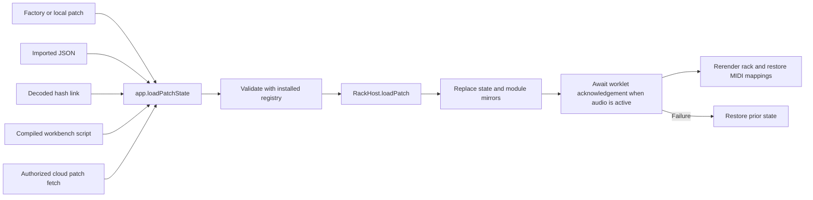

# Cloud patch storage and login plan

This November 13 implementation record documents the original Google-only release. The current sign-in flow also supports Neon managed Better Auth email links delivered through Resend. [Current setup and account behavior](cloud-setup.md)

Add Google login, private and public cloud patches, and a public patch catalogue using Neon and Vercel. Public patches have rack-only preview images, thumbs-up reactions, Save a copy, and stable saved-patch URLs with social previews. Keep the existing browser synthesizer and its current patch serialization and transactional loading boundary. Cloud records store full version 3 JSON, with account, visibility, and community metadata outside the patch state.

This plan and implementation record was updated on 13 November 2026. Users can save privately or publicly and switch an existing patch between those states. New patches default to private. Every copy is initially a private fork and requires a subsequent explicit Save before publication. The existing unsaved, self-contained code URL is a separate feature from a saved patch's permanent URL. Test patches get their own illustrated view; the existing musical demos are archived for later work. Collaborative editing, comments, automatic background synchronization, script storage, and recorded audio uploads are later features.

## Implementation and verification status

The repository now implements the library, cloud API, private/public records, forks, reactions, rack previews, saved pages, Google login adapter, migrations, and build/deployment entry points. Authentication uses **Better Auth hosted on the application's Vercel origin**, with its own session/account tables in Neon PostgreSQL. It does not use managed Neon Auth, browser bearer JWTs, or a JWKS verifier. The Vercel Neon integration's `STORAGE_URL` is accepted as the database connection string; `DATABASE_URL` takes precedence when both exist. At the user's request, preview images now use **private Vercel Blob** through `BLOB_READ_WRITE_TOKEN`; S3-compatible storage remains an optional fallback.

| Status | Evidence and boundary |
| --- | --- |
| Implemented | Current source files are listed below. `npm run build` creates `dist` and a pinned browser vendor bundle; the local Node server executes the same application handler as the Vercel entry point. |
| Full local suites passed | The full unit suite passed 2,398 tests, with the three optional PostgreSQL tests skipped in that run. All 26 Chromium browser tests passed; subsequent focused runs also passed the added legal-page check and final sharing/analytics changes. The preview's 12 focused tests also passed, and actual rack-only PNGs for a small VCO rack and a three-row patch with custom canvas panels were generated and inspected. Fixture identities do not establish real Google login. |
| Real local database checked | All three `tests/server/postgres.integration.test.js` cases passed against a disposable local PostgreSQL 18 database, covering the pinned auth schema, forged-cookie/origin rejection, Google authorization URL construction, and SQL preview/CRUD/fork/like/idempotency/revision behavior. The suite is opt-in with `TEST_DATABASE_URL`, accepts only a dedicated local `eurorack_test` database, and is skipped by default. This does not establish Neon connectivity or complete Google login. |
| Deployed preview checked | A real Vercel preview deployment succeeded. Better Auth/application migrations were applied to Neon from inside Vercel, where the sensitive environment variables are available without downloading them locally. A real private Vercel Blob put/get/delete smoke test passed. These checks establish deployment, schema setup, and storage access, but not a completed signed-in patch workflow. |
| Production configured | Production Google credentials are configured and the live site reports login, patches, and images enabled. The public list reaches Neon, anonymous private lists reject with 401, and Google authorization uses the exact production callback, basic scopes, and PKCE. Clicking Sign in reaches Google's sign-in page. |
| UI and preview follow-up checked | After the compact navigation, single-theme cleanup, visitor-facing copy, and preview caching changes, 130 focused app/preview unit tests and 26 focused Chromium browser tests passed. Desktop and 360px layouts were inspected. |
| Release evidence outstanding | Complete Google sign-in/callback/session renewal/logout and account switching in Chromium and WebKit; exercise the authenticated Neon/Blob patch workflow, cleanup, and public-to-private revocation; verify public social crawlers can fetch the initial metadata and images. The site is deployed; actual Google token exchange still requires a user login. Remaining acceptance criteria below are requirements, not claims of completed provider testing. |

See [Cloud backend setup](cloud-backend.md) and [`.env.example`](../.env.example) for the operational configuration. No account credentials or secrets are generated into browser assets.

## How patches work today

| Area | Source | Current behavior |
| --- | --- | --- |
| Startup | [`EurorackApp.init()`](../src/js/app/app.js) | Initializes the core registry and host, binds the library, preserves unsupported local records, restores an OAuth recovery draft or loads a patch location, then initializes the workbench. Local startup does not wait for login; MIDI permission does not block startup. |
| Persistent state | [`RackState.serializePatch()`](../src/js/app/rack-state.js) | Exports `version`, `plugins`, `modules`, `params`, `cables`, and `midiMappings`. Each module has an instance ID, module type, row, and index. |
| Save and library | [`PatchLibrary`](../src/js/ui/patch-library.js), [`LocalPatchStore`](../src/js/patches/local-patch-store.js) | Coordinates source-qualified active records, dirty snapshots, browser/account destinations, Save and Save a copy. The adapter preserves the name-keyed `eurorack-patches` localStorage bank and prevents a copy from replacing an existing local name. |
| Load | [`loadPatch()`, `loadPatchState()`](../src/js/app/app.js) | Selects a record, normalizes it against the installed registry, calls the host, and rerenders the rack, cables, controls, and MIDI mappings. |
| Audio activation | [`RackHost.loadPatch()`](../src/js/app/rack-host.js) | Saves the prior patch and retained runtime state, replaces module mirrors, and awaits worklet topology acknowledgement. Failure restores prior state and resynchronizes without replacing the still-valid worklet instances. |
| Contract validation | [`normalizePatch()`](../src/js/app/patch-format.js) | Enforces the v3 state shape; with a registry it checks plugin versions, module ownership, parameters, port directions, and cable endpoints. Duplicate input destinations are rejected. |
| URL sharing | [`createPatchUrlHash()`, `parsePatchUrlHash()`](../src/js/app/patch-format.js) | Encodes a compact v2 payload containing v3 state in `#patch=gz1.…`, using gzip and base64url. Uses a frozen core token table, omits default params, and rounds numeric values to three decimal places. |
| File import and export | [`parseImportedPatchJson()`, `createPatchExport()`, `importPatchJson()`](../src/js/app/app.js) | Accepts v3 state, a named envelope, a versioned export, or a patch collection. A single import loads and saves locally; collection import saves records without loading one. Export wraps the current patch in `eurorack-js/patch-export` version 1. |
| Factory content | [`config/test-patches.js`](../src/js/config/test-patches.js), [`config/patches/index.js`](../src/js/config/patches/index.js) | The product imports 75 explicit test entries. The full 113-patch aggregate remains available for regression tooling; 38 musical examples, including the Introduction demo, are preserved in the archive. |
| Workbench | [`PatchWorkbench.apply()`](../src/js/patch-script/workbench.js), [`PatchScriptStore`](../src/js/patch-script/storage.js) | Compiles script source into v3 state and calls `app.loadPatchState()`. Script source lives separately in `eurorack-patch-scripts`. |



Persisted parameters include structured `ui.state` values. Looper audio, CV Recorder lane buffers, DSP phase/history, and other bulk runtime state are excluded. Loading releases transient action buttons while preserving toggles. Empty trailing rack rows are not explicitly serialized; row layout is reconstructed from module placements and the default row count.

## Integration constraints retained

1. **Keep identity independent of names.** The former selector used names as values, allowing a user patch to shadow a factory patch. Use source-qualified references such as `{ source: 'cloud', id }`, with labels kept separate. Existing local records retain their stored format behind an adapter.
2. **Separate saving from sharing.** Persistence and URL creation have independent success states. Private cloud saves must not automatically embed the patch contents in a URL.
3. **Store exact JSON.** Compact URLs deliberately reduce precision and omit defaults. Save `host.serializePatch()` as JSONB, not the compressed URL representation or workbench source. Do not put cloud IDs, ownership, revisions, or visibility into the strict v3 state object.
4. **Preserve transactional loading.** Fetch and validate before calling `loadPatchState()`. Track the active cloud record only after the load succeeds. Cloud loading must never bypass the host to construct DSP instances, alter worklet routing, or write directly into `RackState`. The isolated image renderer may create UI mirrors, but never runs production audio.
5. **Handle asynchronous races.** A delayed fetch must not overwrite later rack edits, another selected patch, or a different signed-in account. Serialize activation, cancel obsolete fetches, and check the current request/account generation before applying results, uploading a captured preview, or reattaching an OAuth draft's cloud identity.
6. **Keep dirty state explicit.** `PatchLibrary` tracks an active record and serialized baseline. Host events do not cover all changes: row changes, module moves, MIDI learn, and telemetry-updated params need consideration. Compare serialized snapshots at save/load boundaries as well as observing user changes; do not drive cloud writes from telemetry.
7. **Strengthen the network boundary.** `normalizePatch()` only checks module contracts when supplied a registry. It is not a request-size limiter, and does not comprehensively validate row/index bounds, MIDI mappings, or parameter types/ranges. Add bounded transport validation before normalization; reuse the registry rules rather than inventing a second module schema by hand.
8. **Avoid destructive library cleanup.** Invalid or newly unsupported records must remain exportable/deletable, with a useful error instead of automatic deletion. The local adapter preserves these records rather than discarding them during startup.
9. **Capture the rack as its own image surface.** The cable SVG is a viewport-sized sibling of the scrollable rack container, and some module panels use canvas. Capturing only the existing rack element would omit cables; capturing the whole page would expose surrounding UI. Rebuild the exact saved rack in an isolated preview surface, including its cables and custom panels.

## Implemented application design

### Browser and deployment

Keep native ES modules and the existing static asset layout. [`scripts/build.mjs`](../scripts/build.mjs) copies `src` to `dist` and bundles pinned Better Auth client, ULID, and `html-to-image` exports into `dist/vendor/cloud.js`. It does not emit environment values or generated server contracts. Public capability flags come from `GET /api/config`; server validation reads static core definitions without creating DSP. Worklet and worker URLs, static core imports, and the existing worklet graph fingerprint remain intact.

Vercel deploys the browser app from `dist` and runs the root-level `api` functions. GitHub Actions builds and tests the app on `main`. Static-only builds retain local patches, test entries, JSON import/export, and embedded snapshot URLs when `/api/config` is unavailable. [Vercel project configuration](../vercel.json) · [Vercel Node runtime](https://vercel.com/docs/functions/runtimes/node-js)

Route `/patches` to the public catalogue and `/patches/:id` to a server-rendered saved-patch page. Route patch image requests through a visibility-aware server handler. Keep those routes out of the static-app fallback. Their initial HTML must contain the correct metadata without requiring JavaScript or starting audio. Use root-relative asset paths on nested routes. A static-only deployment retains local patches and embedded snapshot URLs; the saved/public routes require the backend.

Current files:

| Files | Responsibility |
| --- | --- |
| `src/js/ui/patch-library.js`, `src/index.html`, `src/patch-library.css` | Library sources/views, active record, saves, loading, conflicts, account controls, visibility, reactions, and sharing. |
| `src/js/patches/local-patch-store.js` | Wraps the existing localStorage format and preserves local backups. |
| `src/js/patches/cloud-client.js` | Same-origin cookie requests, typed errors, cancellation, saved/hash locations, and Better Auth login/logout adapter. |
| `src/js/app/app.js` | Existing envelope/import/export helpers and the transactional rack load boundary; helpers were not moved to a separate record module. |
| `src/js/patches/patch-detail.js` | Saved-page session loading, reactions, copying, and sharing without starting the synthesizer. |
| `src/js/config/test-patches.js`, `archive/demo-patches/` | Explicit test catalogue and preserved, exportable musical demo bank. |
| `src/patch-preview.html`, `src/js/patches/patch-preview.js`, `src/js/patches/patch-preview-frame.js` | Serialized immutable-snapshot capture, bounded object-URL cache, and isolated rack rendering with local SVG cables. |
| `server/html.js`, `server/image-store.js`, `server/vercel-blob-image-store.js` | Initial saved-page/social HTML, Sharp raster validation/variants, and private Vercel Blob access; the S3 adapter is retained as a fallback. |
| `api/index.js`, `server/handler.js`, `server/auth.js`, `server/config.js` | Vercel Fetch entry point, routing, Better Auth sessions, capability flags, and configuration. |
| `server/patch-service.js`, `server/postgres-store.js`, `server/validation.js` | Ownership, revisions, forks, reactions, quotas, SQL transactions, and bounded static-contract validation. |
| `db/001-patches.sql`, `db/migrate.mjs`, `db/cleanup.mjs` | Application schema, pinned Better Auth schema migration, and unreferenced image/rate-counter cleanup. |
| `scripts/build.mjs`, `scripts/dev-server.mjs` | Static/vendor build and local server for the production handler or explicitly isolated test backend. |
| `vercel.json`, `.env.example`, `.gitignore` | Deployment routing, documented configuration, and exclusions for secrets/generated files. |

### Authentication

The chosen implementation is pinned `better-auth` hosted by the application's Vercel function at `/api/auth/*`, using its vanilla browser client. Google is the sole configured provider. `server/auth.js` uses the `pg.Pool` adapter and the same Neon PostgreSQL database as patch storage. `db/migrate.mjs` obtains and applies the auth schema from the installed package, including user, session, account, verification, and database rate-limit tables, before the application SQL. There is no managed Neon Auth endpoint or separate auth proxy.

`BETTER_AUTH_URL` (or `APP_URL`) is the exact application origin, with HTTPS required in production. Google must allow `<origin>/api/auth/callback/google`; Better Auth trusts only the configured application origin. Cookies are same-origin and secure on HTTPS. The server uses `auth.api.getSession({ headers })` to identify each caller against the session database, with cookie-session caching disabled. The browser sends `credentials: 'same-origin'`; it does not retrieve/store a bearer JWT. Signing out revokes the session through Better Auth. Never accept an owner ID from request JSON.

Application mutations enforce the exact Origin and reject cross-site fetches. Better Auth also retains its own Origin/CSRF protections and database-backed rate limiter. The local integration suite can verify schema creation, forged-cookie rejection, OAuth state/redirect construction, and origin rejection; it does not follow a real Google consent/callback. Before release, test login, session renewal, logout, redirect recovery, and authenticated Vercel requests in Chromium and WebKit using the real configured provider. Same-origin design removes a separate auth-domain cookie dependency, but it is not evidence that this deployed flow has passed.

Save a recovery draft and intended patch location before redirecting to OAuth. Restore the draft after return or cancellation, then resume only the explicit action the user initiated. Login and cloud-library refresh must not block local rack startup. On logout/account change, cancel pending requests and clear account-specific caches and active cloud identity; the current rack remains available for a deliberate local save or export.

### Database and API

The physical application schema is [`db/001-patches.sql`](../db/001-patches.sql). `patch_records` stores a checked ULID `id` and a `data jsonb` envelope; fields below live in that envelope rather than separate SQL columns. `patch_requests` retains owner/request/hash tombstones after patch deletion, so retries cannot resurrect deleted records. Auth tables are generated separately from the pinned Better Auth package.

| Field | Purpose |
| --- | --- |
| `id text` | Stable ULID primary key generated by the server on creation. |
| `ownerId` | Session-authenticated user ID; internal only, omitted from public projections. |
| `name` | Display name, trimmed and bounded; duplicate names are allowed. |
| `description` | Optional plain-text description, bounded to 1,000 characters. |
| `authorName` | Chosen public creator name, fixed on creation; email-like names are rejected. |
| `state`, `stateHash` | Full canonical v3 state and its server-computed SHA-256 fingerprint. |
| `revision` | Starts at 1; increases on successful edits and visibility changes, independently of reactions. |
| `visibility` | Constrained to `private` or `public`, default `private`. |
| `publishedAt` | First publication timestamp, retained through later visibility changes. |
| `previewId` | ULID reference to a validated preview matching the saved state; required for publication. |
| `parentId`, `parentRevision`, `parentCreatorName` | Immediate parent and copied revision/credit snapshots, retained if the source is deleted. |
| `rootId`, `originalCreatorId`, `originalCreatorName` | Server-derived root identity and creator snapshot preserved through forks of forks; auth subjects are not exposed publicly. |
| `savedAfterCopyAt` | Set by a subsequent explicit content Save. A visibility-only toggle cannot make a fresh fork publishable. |
| `requestId`, `requestHash` | Stable create/copy request ULID and original request fingerprint, retained through edits; owner/request uniqueness makes retries idempotent. |
| `stateBytes` | Server-computed normalized JSON size for quota accounting. |
| `createdAt`, `updatedAt` | Server timestamps. |

Use canonical 26-character uppercase ULID strings for application-generated cloud record, preview, and request IDs. The pinned `ulid` library generates them; API and SQL constraints validate their format. Better Auth also uses the configured ULID generator for its records, while application code treats authenticated user IDs as opaque subjects. A saved patch's ULID identifies its page; access is controlled by visibility and ownership, not by keeping that ID secret.

`patch_previews` likewise stores a ULID and JSONB envelope containing uploading owner, normalized state hash, renderer version, theme, object keys, dimensions, byte counts, and creation time. Pending uploads are private until an authorized save attaches them. `patch_likes` has a unique composite key `(patch_id, user_id)` and creation time; its patch references are ULIDs and user references are auth subjects. SQL cascades reaction deletion when a patch is deleted. Reactions survive a private toggle but remain hidden with the patch.

The first implementation uses expression indexes on owner/creation ULID and a partial public ULID index. Both lists use descending creation ULID with an exclusive ULID cursor. This is an explicit simplification from the planned latest-update/latest-publication ordering, keeping pagination stable across edits and visibility changes. Revisit ordering if the catalogue needs publication recency. Aggregate thumbs-up counts without exposing voter identities. Names do not need a unique constraint. Keep schema version 3 distinct from the record's optimistic-concurrency revision. Cloud v1 accepts core modules only; external trusted plugins need a separately provisioned server contract before cloud storage can validate them. Local/plugin workflows continue using their installed registry.

`server/postgres-store.js` uses parameterized `pg.Pool` queries over the configured PostgreSQL URL, not Neon's HTTP driver. A shared advisory transaction lock serializes mutations that depend on visibility, quotas, revisions, and image associations. Image access uses a single fresh joined statement outside that lock, returning only access and preview metadata; byte reads are followed by another current-access check. Catalogue profile and reaction projections use batch queries. Keep database credentials server-only and application tables inaccessible to anonymous/direct Data API roles.

| Endpoint | Behavior |
| --- | --- |
| `GET /api/config` | Returns public capability flags and limits, never credentials. Incomplete auth/database configuration keeps cloud disabled while local workflows remain available. |
| `/api/auth/*` | Better Auth's Google OAuth, session, and logout endpoints on the application origin. |
| `GET /api/me` | Checks the session and returns minimum account information or `user: null`. |
| `GET /api/patches?cursor=…` | Owner-only metadata list, up to 50 records per page; omits patch bodies. |
| `GET /api/public-patches?cursor=…&q=…` | Anonymous catalogue of public patch summaries, preview URLs, chosen public author names, module counts, and thumbs-up totals. Bound search and page sizes. |
| `POST /api/patch-previews` | Authenticated multipart raster upload with exact v3 JSON; computes its normalized state hash, validates/re-encodes the image, and returns a pending preview ULID/hash. |
| `POST /api/patches` | Creates from `{ requestId, name, description, authorName, state, visibility, previewId }`; visibility defaults to private, and public requires a matching ready preview. Same request/body retries return the existing record without replacing later edits; changed content with the same request ID conflicts. |
| `GET /api/patches/:id` | Owner can read their full record; other readers receive a public-safe projection only when visibility is public. Never expose account email or auth subjects publicly. |
| `PUT /api/patches/:id` | Replaces saved content with `expectedRevision` and a matching preview for public content. Ownership/revision checks and attachment are atomic; ordinary Save retains visibility. |
| `DELETE /api/patches/:id` | Owner-only deletion with an expected revision; immediately removes patch/image access and reactions. Unreferenced preview associations and objects are removed by grace-period cleanup. |
| `PUT /api/patches/:id/visibility` | Owner-only private/public transition with `expectedRevision`; making public requires a preview of the current saved state. Making private must work immediately without generating an image. |
| `PUT /api/patches/:id/like` | Signed-in user sends `{ liked: true/false }` for a public patch. Idempotently inserts/removes their single reaction and returns the new total and own reaction state. |
| `POST /api/patches/:id/copies` | Forks an accessible saved record into the caller's account with a fresh ULID, request ID, expected source revision, and chosen name. Always private with no later-save marker. Server derives root creator and immediate parent; reactions and publication settings are not inherited. |
| `GET /patches/:id` | Server-rendered public details and metadata, or a generic unavailable/private shell with no patch-specific data for unauthenticated readers. The owner can authenticate to load private details. |
| `GET /patches/:id/images/:previewId/:variant` | Returns a bounded raster only if the patch is public and references that active preview; private owners use an authenticated image request. |

Return clear errors for invalid data, missing authentication, inaccessible records, revision conflicts, oversized payloads, quota/rate limits, and temporary backend failure. Inaccessible private records and nonexistent IDs use the same not-found response. Expired sessions require renewed sign-in while preserving the rack; do not silently replay mutations. Any deliberate retry retains its request ID or revision protection.

Use `Cache-Control: no-store` for patch responses, catalogue results and saved-patch HTML. Images use `private, no-cache, max-age=0, must-revalidate`, `Vary: Cookie`, and an immutable-byte ETag. Every GET, HEAD and conditional 304 checks current access; the Vercel/shared response CDN remains `no-store`. Browsers can retain bytes but cannot reuse them without validation. Serialize visibility changes against edits/reactions/copies. Existing saved URLs keep their ULID when visibility changes; they reveal no patch content to other users while private. Already downloaded copies, browser-displayed pixels, and third-party social caches cannot be recalled.

Public patches expose the latest explicitly saved content. Editing the rack alone does not publish changes. Each public save attaches matching JSON and a validated preview atomically; failed image capture/upload leaves the previous public revision intact. The user can instead save the new work privately through an explicit action. A visibility-only toggle publishes the saved revision, with a clear prompt to save first if the rack has unsaved edits.

### Validation and usage limits

`server/validation.js` builds a metadata-only registry from `CORE_MODULE_DEFINITIONS`, exposing core ownership/version, HP, parameter declarations, and port contracts to the existing `normalizePatch()`. It does not call `loadCorePlugin()` or `createDSP()` on the server. A generated metadata artifact was unnecessary for this implementation; the shipped definitions remain the single contract source. The server must not instantiate user racks or fetch arbitrary plugin URLs.

Validate raw input types and bounds before rack construction. Current limits include 256 KiB state JSON, bounded HTTP bodies, 128-character names, 256 modules, 2,048 cables, 32 rows, 84 HP per row, and 24 levels of structured nesting. Bound strings, MIDI mappings, arrays, row/index integers, and plugin versions; reject dangerous object keys used in property paths. Require cloud module instance IDs to use a bounded safe character set. Render patch names as text. These limits belong to the cloud boundary and must not silently truncate local patches.

Start with 100 patches and 10 MiB of normalized state per account. Enforce count and byte limits in a transaction that serializes mutations for the same owner, including concurrent creates and updates. Use bounded database-backed request counters or an equivalent shared limiter for writes; process-local counters alone do not enforce limits across serverless instances. Keep anonymous reads bounded and monitor their use.

On 13 November 2026, all 112 factory patches were loaded into `RackState` and serialized with defaults, without creating DSP. JSON sizes ranged from 523 to 7,639 bytes; the middle entry was 1,352 bytes. The largest module count was 31 and the largest row number was 4. These are representative examples, not bounds on user-created patches or estimates of Postgres disk usage.

The cost target remains free-tier operation at small scale. Recheck current Neon database allowances and Vercel hosting/Blob allowances and plan eligibility before production launch, then watch database compute, function duration, Blob storage, and image egress. Managed Neon Auth MAU allowances are not relevant to this self-hosted Better Auth design. [Neon pricing](https://neon.com/pricing), [Vercel pricing](https://vercel.com/pricing)

## Art direction and rack images

Industrial Light uses warm paper `#f0eee2`, near-black ink `#0b0b09`, safety orange `#ff4a0a`, monospace type, square corners, strong rules, and compact labelled controls. Reuse the existing theme tokens rather than introducing a separate gallery palette. Module height is 360px. HP widths and actual rack geometry come from the renderer. The top-bar Dark mode toggle restores the saved Industrial palette across the rack, library and standalone pages. The visual contract is in [`src/index.html`](../src/index.html), [`midi-tools.css`](../src/midi-tools.css), and [`hardware-controls.spec.js`](../tests/e2e/hardware-controls.spec.js).

Build the public and test views as a continuous ruled catalogue: rectangular entries with shared borders, rack images filling most of each entry, and compact title/credit/action strips outside the image. Search, navigation, visibility choices, thumbs-up, and Save a copy use the existing outlined control vocabulary. Gallery controls and captions follow the selected mode. Let entries reflow on narrow screens; do not scale an entire desktop page down. Use visible text for Private/Public and selected reaction state, with keyboard operation and focus styles. The compact navigation sits above the rack controls; rack controls are hidden in library views.

**Every preview image is rack-only**, including social images. Show module panels, control positions, rails, and patch cables. Exclude toolbars, sidebars, account controls, gallery captions, workbench, pointer/hover states, browser chrome, and added title/logo banners. Public previews follow the selected Industrial palette. Patch name and creator belong in surrounding page text and social metadata, not overprinted on the rack image.

Capture from the immutable v3 snapshot being saved in a same-origin preview iframe/page. Reuse `renderModule()` and custom panels, render idle canvas displays once, and create a rack-local cable SVG using the existing cable path helper with local coordinates. The live cable SVG is a sibling of the rack and uses viewport coordinates, so a simple rack-element capture is insufficient. Never start MIDI, audio, workbench evaluation, or analytics in the preview surface. Wait for fonts and layout, capture all occupied rows, preserve relative module sizes, and clean up UI mirrors and animation loops.

The implementation pins `html-to-image` 1.11.13, with actual Chromium raster inspection covering module controls, SVG cables, and custom canvas panels; WebKit fidelity remains a release check. The iframe loads the shared Industrial palette and the application's inline rack CSS. It renders real modules at native HP in both Industrial palettes. Every preview trims unused trailing rail to the widest occupied row, with an 8 HP minimum and space for rail outlines and cables; module sizes, row placement, and cable sag stay intact. Captures are serialized, capped at 1600×1600/2.56 million pixels, and cleaned up after each use. [Project documentation](https://github.com/bubkoo/html-to-image) The server creates a bounded full raster, a catalogue thumbnail, and a 1200×630 PNG social variant that fits the rack against its own background. Do not rearrange modules or crop away occupied rows to fill the frame. Large racks can open the full preview or the actual patch for inspection.

Each of the 75 Test patches has a pre-rendered light and dark WebP thumbnail of up to 640×480. Both sets together occupy 3.69 MB. Their content-hashed URLs are cacheable for one year. The manifest verifies patch state, palette and renderer version. Saving a browser patch caches both thumbnails in Cache Storage, bounded to 96 entries and 24 MiB. Account images use the authenticated HTTP cache.

To regenerate test thumbnails after patch or renderer changes, run `npm run dev:previews` and, in another terminal, `npm run build:test-previews -- http://127.0.0.1:4176`, then rebuild. Bump `PATCH_PREVIEW_RENDERER_VERSION` when rack rendering changes. Commit the generated manifest and WebP assets together; focused tests verify patch-state freshness, dimensions, size bounds, and content hashes.

Store raster bytes outside JSONB in a **private Vercel Blob store**, configured with the server-only `BLOB_READ_WRITE_TOKEN`. `server/image-store.js` selects the private Blob adapter when that token is present; `server/vercel-blob-image-store.js` performs private object access. `STORAGE_URL` configures PostgreSQL, not images. Keep objects private even when their patch is public; never expose provider URLs that bypass later privacy changes. Immutable ULID object paths use Blob's private CDN (`useCache: true`, one-year object cache lifetime). A separate per-function byte cache is bounded to 128 entries/32 MiB and deduplicates simultaneous downloads. Neither layer stores access decisions. [Vercel private storage](https://vercel.com/docs/vercel-blob/private-storage)

Every normal account Save captures the same rack snapshot in light and dark mode. Each palette gets a WebP thumbnail bounded to 640×420, a full PNG bounded to 1600×1600, and a 1200×630 social PNG. All six share a preview ID and attach in a single patch update. Loading a public or account catalogue page generates missing artwork and checks older pairs for blank thumbnails. The server captures the rendered rack and replaces a blank palette under fresh URLs. The previous light image stays visible during generation. Saving an unchanged rack also creates the pair. Save retries reuse the completed upload. An unchanged fork can share paired bytes under its own authorized association. Social metadata points to the light social image.

The production daily cron calls `/api/internal/cleanup-previews` with `CRON_SECRET`. Each run detaches up to 25 previews older than 24 hours with no saved-patch reference, then retries up to 75 queued object deletions with concurrency five. Shared fork objects are kept until every preview association is gone. Failed deletions stay queued. This bounds provider operations per run and prevents abandoned/superseded uploads accumulating indefinitely at current traffic; monitor backlog as traffic grows. The existing 1 MiB combined-variant and 50 MiB account-media quotas remain enforced. [Cron authentication](https://vercel.com/docs/cron-jobs/manage-cron-jobs), [daily scheduling limits](https://vercel.com/docs/cron-jobs/usage-and-pricing)

The S3-compatible adapter remains an optional fallback when no Blob token is configured. It requires a separately configured private bucket and its endpoint/credentials; it is not the selected deployment storage. Keep the same visibility-aware application route and cleanup/reference rules with either provider.

Treat uploaded images as untrusted: allow bounded raster formats, decode and re-encode them server-side, strip metadata, cap source dimensions/decoded pixels, and reject SVG or arbitrary remote image URLs. Each palette allows a source of up to 2 MiB and 8 megapixels. Keep generated variants within 1 MiB per palette and enforce a 50 MiB media allowance per account. Store theme/renderer version and a canonical state hash with each preview. Only the owner can attach their pending upload to matching state; a late upload cannot replace a newer preview. Remove abandoned uploads and unreferenced older images with bounded cleanup.

Private saves can succeed while their preview is unavailable and offer a retry. First publication and subsequent public content saves require a matching ready image. Reuse a verified raster for identical fork state, but create an independently authorized preview association so making the parent private does not break the fork's image.

## Saved patch URLs and social previews

Use `/patches/<ulid>` as the canonical saved-patch URL, opening directly in the rack. The optional Details view includes the description, chosen public author name, original creator credit, rack preview, thumbs-up total, Save a copy, and sharing actions. Copy link and native/social sharing use the canonical rack URL. Public browsing and opening require no login; cloud saves, forks, and reactions require login. Audio starts only on request.

Return metadata in the initial HTML: title and description, canonical URL, `og:type=website`, `og:title`, `og:description`, `og:url`, `og:site_name`, and an absolute HTTPS `og:image` with type, dimensions, and alt text. [Open Graph specification](https://ogp.me/) Add `twitter:card=summary_large_image`, title, description, image, and image alt text. The documented output examples provide the tag contract without requiring a framework migration. [Twitter metadata output](https://nextjs.org/docs/app/api-reference/functions/generate-metadata#twitter) Escape all user-provided metadata and bound its length.

Images must be retrievable by anonymous social crawlers while the patch is public, without cookies, JavaScript, or login redirects. Use preview-versioned image paths so saved changes have a new image identity. Keep pages and images small and test actual initial response HTML, status, content type, and image bytes. Check previews on X/Twitter and representative Open Graph consumers such as Facebook, LinkedIn, and chat apps before release. Native share and optional platform share links open a composer; they do not post automatically or require a paid social API.

Private or deleted patches return no patch-specific title, creator, description, state, or image to an anonymous crawler. Use a generic unavailable page with `noindex` and no patch-specific social card; missing and inaccessible records are indistinguishable. Owners retrieve private content after authentication. Public-to-private changes remove catalogue access and deny new public page/image/data fetches. Social platforms may retain material fetched while public; do not promise that changing visibility removes their cached previews.

The existing `/#patch=gz1.…` remains the **unsaved snapshot/code URL**: self-contained, backend-free, and a fixed snapshot. It never becomes a saved record, fork, public listing, or reaction target merely by being copied. Its fragment cannot provide a server-generated per-patch social card. Keep its action labelled Copy snapshot link, distinct from Copy saved patch link. Never silently publish or upload an unsaved snapshot when sharing it.

## Library and sharing behavior

The existing patch dropdown and its Load/Delete controls are replaced by explicit Rack, My patches, Public patches, and Test patches views. My patches distinguishes This browser from My account and shows private/public state for account records. Public patches is a searchable, paginated image catalogue with thumbs-up totals; current ordering uses descending creation ULID as described above. Opening a view must preserve the current rack and unsaved edits. Keep an active patch label and save destination, with distinct **Save** and **Save a copy** options.

Save updates an active writable local/owned cloud record. New saves offer Private/Public, with private preselected; subsequent saves retain existing visibility unless the user explicitly changes it. Owners can toggle an existing patch between Private and Public without changing its ULID. A new fork must be saved again before it can become public: a publish attempt offers Save and publish and uses the explicit content-save path. Enforce this with `savedAfterCopyAt`, not `revision > 1`, because other edits can increment revision.

Save a copy in the editor captures the current rack, including unsaved edits. In a catalogue/detail view it copies that item's saved snapshot, not an unrelated open rack. Ask for a name and destination; suggest `<name> (copy)` and prevent replacement of existing local names. Signed-out users can save locally or sign in for an account fork. Every cloud fork gets a new ULID, revision 1, the copying user as owner, private visibility, no reactions, and no later-save marker. Retrying the same copy request cannot create duplicates. Module IDs and cable endpoints remain internally consistent.

In the editor, a successful copy becomes active; newer edits made during the request remain unsaved. A catalogue copy offers Open copy without replacing an edited rack automatically. Cancellation or failure preserves the original active record and rack. Copying never changes the source or its visibility.

Forks retain original creator credit, including forks of forks. Derive parent/root IDs and original creator credit on the server from an authorized source; never trust caller-supplied lineage. Show Owned by the current user and Original by the root creator, with an immediate-parent link when that source is still public. Keep a minimal attribution snapshot/tombstone when sources are deleted or made private, without exposing their current private contents or account email. Forks are independent: no automatic updates from the parent. Local exports/imports should preserve established fork metadata separately from v3 state, but imported unverified claims must not be presented as verified server lineage.

Signed-in users can add or remove one thumbs-up on another user's public patch. Use an accessible pressed-state control and a visible count. Unauthenticated users are invited to sign in and return to the patch. The database uniqueness constraint and idempotent like/unlike request prevent double counts on retry. Private patches cannot receive public reactions. Forks begin with zero reactions; later reactions on a parent do not propagate to copies.

Keep existing local records as local copies. Offer an explicit upload action for selected local patches after login, with per-record results and idempotent retries. Do not bulk upload on login. Names remain labels, so two sources can contain the same name without hiding each other.

Use these distinct navigation forms:

| Location | Meaning |
| --- | --- |
| `/patches` | Public image catalogue. |
| `/patches/<ulid>` | Canonical rack editor and social-sharing URL; access depends on visibility and ownership. |
| `/patches/<ulid>?view=details` | Optional patch description, credits and social actions; Open in rack returns to the canonical URL. |
| `/#saved=<ulid>` | Legacy editor links still load, then normalize to the canonical saved URL. |
| `/#patch=gz1.…` | Existing unsaved embedded snapshot; loads without a backend. |

Saving or opening an account patch updates the editor address to `/patches/<ulid>`. Refreshing that address loads the saved rack directly. New editor URL creation removes competing selectors. Reject ambiguous saved/snapshot links with an actionable message. Handle initial load, hash navigation, and back/forward navigation without update loops. Do not log auth tokens or patch contents. Saved link copying always emits the canonical path URL; unsaved snapshot URLs are rooted at `/#patch=`, never appended to a saved path.

Before replacing an edited rack, offer Save / Discard / Cancel. Snapshot dirty state at the start of a fetch and recheck before application so edits made while the request was pending cannot be lost. Disable overlapping rack replacement while worklet activation is pending. Capture the exact snapshot for an outgoing save; edits made during the request stay marked unsaved after it completes.

Sharing clearly distinguishes Copy snapshot link from Copy saved patch link. For a private saved patch, show that its URL is owner-only and offer the explicit publication action. Public links follow saved updates; unsaved edits are not included. Explain publication in the save/visibility control, independently of generating an embedded snapshot link.

On network/save failure, leave the rack and dirty state intact, show Retry and Save locally/Export, and never display cloud success before acknowledgement. On `409`, offer Reload latest or Save a copy; do not overwrite the other revision automatically. Deleted, newly private, invalid, or unavailable patches leave the current rack intact with an error.

If deployment changes origin, localStorage from the old origin is not visible at the new one. Prefer retaining the existing public origin; otherwise provide export/import instructions on the old deployment before migration. Login is not a mechanism for transferring that browser storage.

## Test patches and demo archive

Remove `#patchSelect` from the product instead of keeping a hidden legacy selector. The Test patches view contains the 75 current test patches as rack-image entries with Open in rack and Save a copy. Test previews are generated ahead of deployment from the same rack renderer and loaded lazily as static WebP images; opening the catalogue does not instantiate every rack or start audio. Keep this view distinct from community uploads and personal patches.

Preserve all 37 non-test musical examples in `archive/demo-patches/` with an index, original source names, and an importable v3 JSON collection for later editing. This includes 27 demos, four SFX patches, and six drum examples; `Demo: Trip-Hop` uses a different naming separator. Define catalogue membership explicitly rather than relying on name prefixes. The archive is not automatically uploaded or shown in the normal UI.

Maintain the full 113-patch aggregate for regression tooling while the application imports only the test catalogue. Update dropdown-driven browser tests to open test entries through the new view. Preserve demo audio tests by importing archived fixtures through the supported load boundary. Update patch-registration instructions, architecture documentation, and the synth-voice guide to distinguish test entries, archived examples, and user/community patches.

## Implementation milestones and remaining release gates

The application code for these milestones is present. Acceptance statements remain the release contract; local fixtures and isolated SQL tests do not replace live-provider verification.

### 1 Authentication and deployment

Implemented: static/vendor build, Vercel routing, capability configuration, same-origin Better Auth Google/session routes, and the identity endpoint. A real Vercel preview deployment succeeded. Remaining: finish Google client configuration and verify real login/callback, logout, session renewal, redirect recovery, and cookies in Chromium and WebKit. Keep preview and production Neon/Blob/OAuth configuration separate and complete authenticated deployment smoke checks before production launch.

Acceptance: a signed-in browser can call owner-only endpoints; missing, forged, expired, or revoked sessions cannot. Cross-origin mutations fail, while intentionally public endpoints remain anonymous. A static build with cloud disabled still loads and plays patches. Database credentials are absent from output assets. Production account provisioning and domain credentials are deployment tasks.

### 2 Extract the patch library boundary

Implemented: `LocalPatchStore`, source-qualified references, active-record/dirty-state coordination, library/test views, the 38-example archive, and independent save/link actions. Existing envelope/file helpers remain in `app.js`; the source boundary was extracted without a separate record helper file. Preserve JSON import/export, legacy hash behavior, and load coordination at `loadPatchState()`, including workbench Apply.

Acceptance: local saves, the 75 test entries, and all archive fixtures round-trip; the old dropdown is absent; identical names across sources remain distinct; failed loads preserve the prior active identity; unsaved-state recovery works without cloud configuration.

### 3 Add schema and the private patch API

Implemented: pinned Better Auth/application migrations, static metadata validation, session identity, owner/public access checks, quotas, idempotent create/copy, and revision conflicts. Real PostgreSQL tests passed on a disposable local database, including concurrent writers. The selected Neon schema was also migrated successfully from inside Vercel using its sensitive environment. Remaining: exercise real signed-in account persistence and ownership through the deployed application once Google credentials are configured. Keep request handlers testable without deployment.

Acceptance: one user can create/list/read/update/delete their patches; another user cannot access them. Invalid patches never enter the database. Concurrent updates produce one success and one conflict, and concurrent creates cannot exceed quota.

### 4 Connect login and the account library

Implemented: account controls, cloud summary listing, fetch-on-load, Save/Save a copy, explicit local uploads, saving status, OAuth draft recovery, and account-change cancellation. Keep local startup independent of auth/network completion. Snapshot and load exclusively through the current host API. Verify delayed captures, stale searches, draft reattachment, and revision-conflict copy recovery before release.

Acceptance: save in one browser context, sign into a second context, load the same exact state, and play it. Save a copy produces an independent private record with a new ULID, leaves the source unchanged, and becomes the active record only after success. Failed saves retain edits; signing into another account cannot display or apply results from an earlier request.

### 5 Add rack images and the public catalogue

Implemented: isolated rack capture, private Vercel Blob adapter/Sharp variants, optional S3 fallback, validation, atomic public saves, Industrial catalogue views, visibility controls, reactions, and independent private forks with root creator attribution. Test patches use the same rack-only image pipeline. Real private Blob put/get/delete passed. Remaining: exercise signed-in upload/save, account/image limits, cleanup, and visibility revocation through deployed routes. Route every editor load through `loadPatchState()`.

Acceptance: anonymous users browse/open public patches; privacy changes protect data and images; one user cannot react twice; copies retain creator lineage, remain private, and require another Save before publication. Every published image depicts its saved rack without surrounding UI. Failed uploads preserve the prior public revision.

### 6 Add saved pages and social previews

Implemented: canonical `/patches/<ulid>` HTML, rack-only social variants, initial Open Graph/Twitter metadata, and separate saved-link/snapshot-link actions. Handler tests cover public/private/deleted routes and generic private metadata. Remaining: inspect the deployed initial HTML and image bytes with anonymous requests and real social preview consumers.

Acceptance: a saved public patch URL provides a matching social image and creator credit; private URLs reveal only generic metadata; unsaved code URLs continue to work independently. The saved URL and fork lineage persist through visibility changes.

### 7 Validate and prepare release

Completed locally: the full unit suite passed 2,398 tests (three optional PostgreSQL tests skipped in that run), and all 26 Chromium browser tests passed, followed by focused final legal/sharing/analytics checks. The three real local PostgreSQL integration tests passed separately. A Vercel preview deployment, Neon migrations, and private Blob storage smoke also succeeded. Finish real Google OAuth/WebKit, authenticated end-to-end persistence/privacy, and public social-crawler checks before production launch. Document environment setup, backups/export, quotas, deployment roots, preview configuration, cleanup, and origin migration. Prefer manual saves and metadata-only listing initially; add caching or automatic saves only with measured demand.

## Test and release criteria

| Layer | Required coverage |
| --- | --- |
| Patch compatibility | Exact JSON round trips including structured state, precision, rows, MIDI mappings, transient actions, and plugin versions; legacy hash decoding and file import/export remain valid. Runtime buffers remain excluded. |
| Server validation | Malformed/oversized bodies, deep nesting, unknown modules/params/ports, missing plugin declarations, duplicate destinations, row/HP bounds, and metadata parity with the shipped core registry. |
| Auth and ownership | Missing/forged/expired/revoked database sessions, Google state/callback and renewal/logout behavior, exact trusted origins/CSRF, user A versus user B on every private endpoint, and no owner/email disclosure in shared responses. |
| Database | ULID constraints, idempotent request reuse, revision/quota races, visibility changes, preview attachment, and independent fork provenance; one reaction per user/patch. |
| Browser coordination | Auth redirect draft recovery, logout during requests, editing during fetch/save, competing loads, dirty replacement cancellation, fetch failure, account switching, and localStorage failure. |
| Save a copy | Test/local/owned/public sources; editor edits versus catalogue snapshots; new ULID and private ownership; later-save publication gate; root credit through forks of forks; deletion/private source behavior; no source mutation or inherited reactions; retries and unsaved-state preservation. |
| Public catalogue | Public-only search/list/detail/image access, private/public toggles, one reversible thumbs-up per signed-in user, current visibility checks during concurrent forks/reactions, and no private source links or auth subjects in attribution. |
| Rack previews | Rack-only content, multi-row cables, custom canvas panels, control positions, theme rules, bounded images, malformed uploads, stale image rejection, source-independent copied previews, and no live rack/audio changes. |
| Social sharing | Initial HTML metadata without JavaScript, absolute image URLs and raster bytes, generic private/deleted responses, saved path versus unsaved hash links, image refresh on changed state, back/forward navigation, and platform preview smoke checks. |
| Audio and static assets | Patch load while audio runs, worklet rejection rollback, preserved MIDI mapping behavior, startup without auth, native module/worker/worklet URLs, and existing demos. |

API tests live under `tests/server/` with an explicit Node environment; the default Vitest environment remains jsdom. Focused library/client and preview tests live under `tests/app/` and `tests/patches/`. Playwright now starts `npm run dev:test`, which builds `dist` and serves `scripts/dev-server.mjs` with an explicitly test-only identity/image adapter. That adapter refuses production/Vercel use and is not imported by the production API. The checked-in Playwright project is still Chromium-only: add or run a separate WebKit/provider smoke configuration before release. The 25 passing fixture browser tests do not complete Google OAuth or exercise the deployed Neon/Blob workflow.

Existing baseline command, run during planning:

```bash
npm test -- tests/app/patch-format.test.js tests/app/patch-file-json.test.js tests/app/rack-host.test.js tests/app/rack-state.test.js tests/patch-script/workbench.test.js tests/config/factory-patches.test.js
```

Planning baseline result: 6 files and 100 tests passed. This remains historical compatibility evidence; the cloud implementation and its focused tests were added subsequently. The status table above distinguishes observed local validation from outstanding provider checks; record final full-suite/browser results with the release rather than treating this baseline as cloud coverage.

Before release, run `npm test`, the added real-database integration suite, `npm run test:e2e`, and the cloud/auth browser checks against the built deployment. A DSP audit is only needed if implementation changes DSP; this feature should operate above that layer.

## Deployment inputs

Use the existing Vercel project with repository-root build context, Node 22 or newer, `npm run build`, and `dist` output. A real preview deployment has succeeded; complete the remaining authenticated and crawler route checks on that deployment, since the local server does not emulate Vercel's routing platform. Keep preview and production database branches, OAuth configuration, secrets, and private Blob stores isolated. Confirm the selected integrations' environment mapping rather than assuming a database attachment configured auth or images. [Neon and Vercel integration](https://neon.com/docs/guides/vercel-overview)

| Input | Current use |
| --- | --- |
| `STORAGE_URL` or `DATABASE_URL` | PostgreSQL connection string for both Better Auth and patch records. `DATABASE_URL` wins if both are present; `STORAGE_URL` must have a PostgreSQL protocol. |
| `BETTER_AUTH_URL` or `APP_URL` | Exact app origin; HTTPS in production. `BETTER_AUTH_URL` wins if both are present. |
| `BETTER_AUTH_SECRET` | Server-only session/auth secret of at least 32 characters. |
| `GOOGLE_CLIENT_ID`, `GOOGLE_CLIENT_SECRET` | Google OAuth app configured for `<origin>/api/auth/callback/google`. |
| `BLOB_READ_WRITE_TOKEN` | Selected image provider: server-only token for a **private Vercel Blob** store. It takes precedence over S3 settings. |
| Optional `S3_ENDPOINT`, `S3_BUCKET`, `S3_ACCESS_KEY_ID`, `S3_SECRET_ACCESS_KEY` | Fallback image provider only when no Blob token is configured; use a private bucket. |
| Optional `S3_REGION`, `S3_FORCE_PATH_STYLE` | Provider-specific fallback S3 settings; unnecessary for Vercel Blob. |

`npm run db:migrate` applies the installed Better Auth schema and `db/001-patches.sql`; it can prepare a database before Google provisioning and does not test Google login. Run `npm run dev` for the built application/production handler locally, or `npm run dev:test` only for isolated fixture identities. Production image cleanup is scheduled daily in `vercel.json` and requires `CRON_SECRET`; `npm run db:cleanup` remains available for manual bounded batches and expired rate-counter cleanup. Configure actual secrets only in ignored local environment files and provider settings; public capabilities come from `/api/config`.

Cloud is disabled when required auth/database/origin configuration is incomplete, including the currently outstanding Google credentials. Image storage has a separate capability flag: private JSON saves remain possible without configured image storage, but public saves need a matching ready image. Review runtime errors, cleanup cadence, and backup/export procedures on the deployed preview before production launch.

The first release includes Google login, private/public patches, rack-only images, a public catalogue, thumbs-up, private forks with creator credit, saved social URLs, a test-patch view, and the demo archive. GitHub login, script-source syncing, audio storage, comments, and collaboration can follow separately. The user has authorized implementation after planning; account credentials and deployment inputs remain external configuration.
